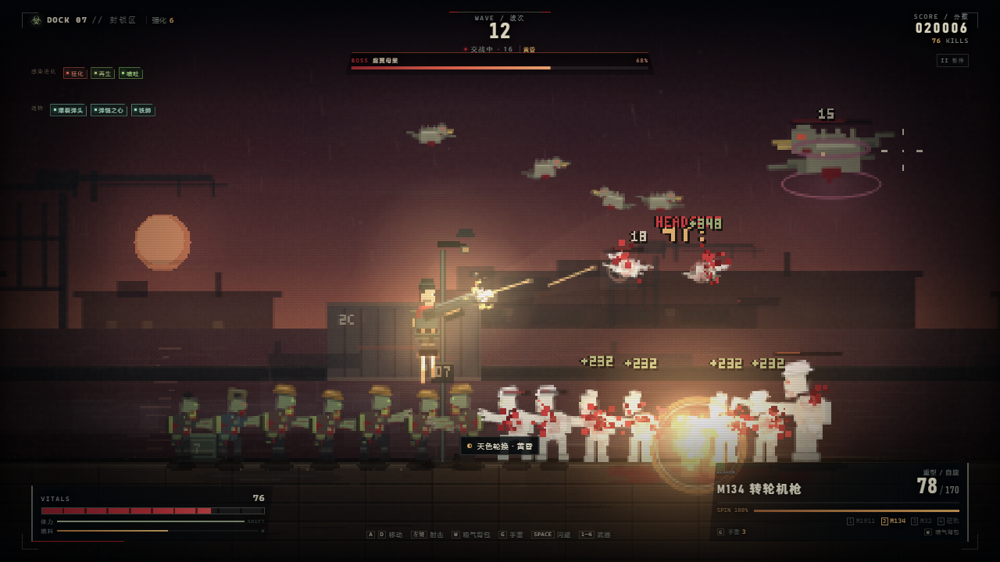
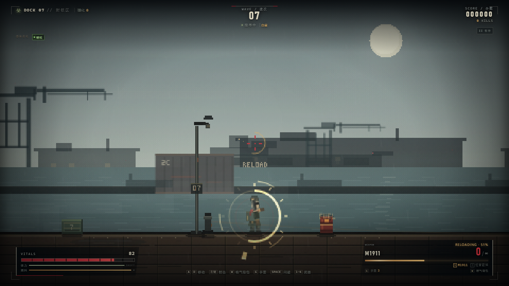
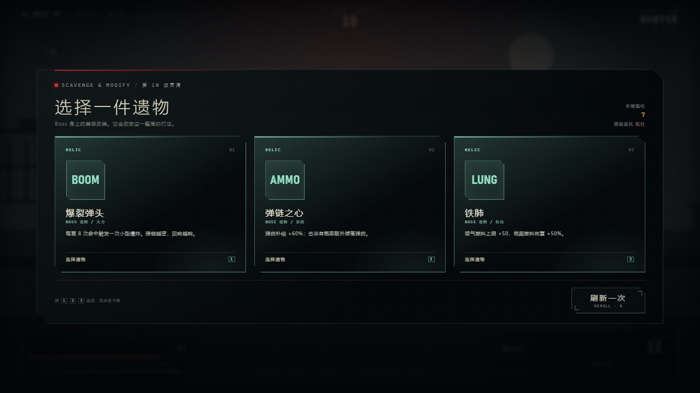
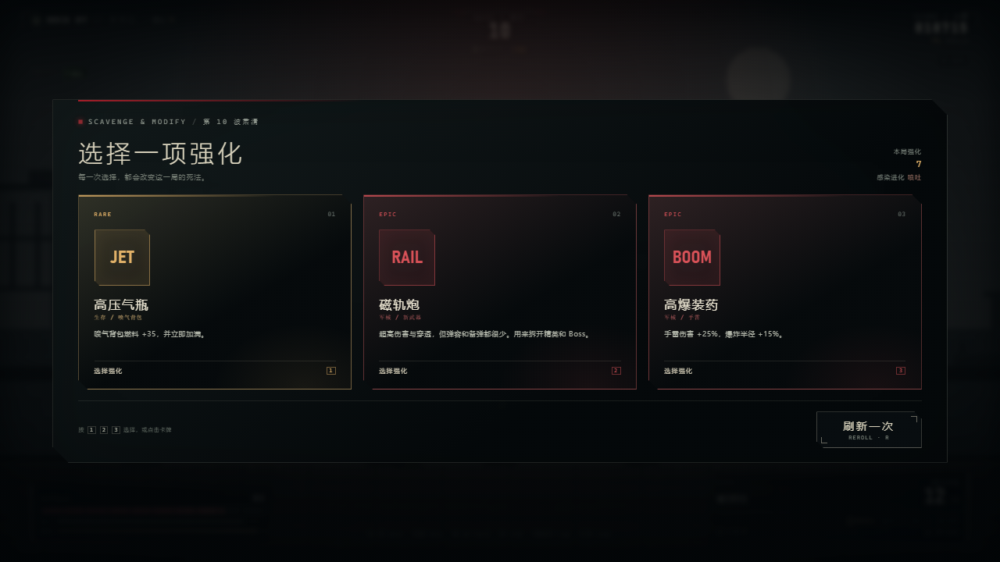
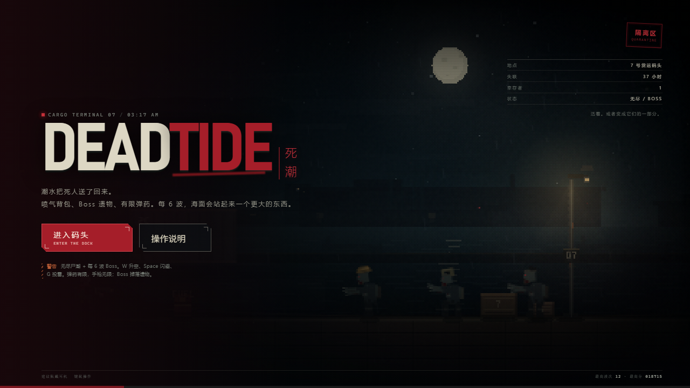

# 死潮 · DEAD TIDE

一个可以直接在浏览器中运行的像素风 2D 横版僵尸生存游戏。

**在线游玩：** https://lanmeibuxie.github.io/dead-tide/

失联的 **7 号货运码头**，潮水把死人送回了岸上。你要在暴雨、雾气和不断闪烁的码头灯之间活下去。尸潮没有终点；每 **6 波**会有一个 Boss 登岸，击杀后从三件 **遗物** 中选择一件，彻底改变这一局的构筑。弹药不再是无限的，M1911 手枪是最后的保险。



## 截图

| 换弹动画 | Boss 遗物 |
| :---: | :---: |
|  |  |
| **分段换弹与 HUD 进度** | **击杀 Boss 后的遗物选择** |

| 波次强化 | 标题画面 |
| :---: | :---: |
|  |  |
| **每波结束的三选一强化** | **死潮标题与码头夜景** |

## 运行方式

不需要安装依赖，也没有构建步骤。

- 直接双击 `index.html` 用现代浏览器打开即可。
- 也可以开一个本地静态服务器：

```bash
python -m http.server 8080
# 或
npx serve .
```

然后访问 `http://localhost:8080`。

建议使用桌面版 Chrome / Edge / Firefox，并佩戴耳机。

## 操作

| 按键 | 动作 |
| --- | --- |
| `A` / `D` 或 `←` / `→` | 左右移动 |
| 鼠标移动 | 瞄准 |
| 鼠标左键 | 开火（按住连射；转轮机枪需要预热） |
| `Shift` | 消耗体力冲刺 |
| `W`（按住） | 点燃喷气背包升空；落地后补充燃料 |
| `Space` / `Q` | 闪避，短暂无敌 |
| `G` | 投掷手雷 |
| `R` | 换弹 |
| `1` – `4` | 切换武器槽 |
| 鼠标滚轮 | 循环切换武器 |
| `Esc` / `P` | 暂停 |
| `M` | 静音 / 恢复声音 |
| `Enter` | 标题界面开始 / 结算界面重新开始 |

## 无尽、Boss 与遗物

- 尸潮为 **无尽模式**，死亡才会结束；本地记录最高分与最高波次。
- 每波肃清后从 3 张随机强化中选 1 张，可免费刷新一次。
- **每 6 波**（第 6、12、18……波）会出现 Boss。Boss 有独立血条、专属攻击模式和召唤/狂暴阶段。
- Boss 类型轮换：
  - **潮汐暴君**：冲锋与地面震荡波，逼迫你升空或横向位移。
  - **腐翼母巢**：空中俯冲，召唤鸟群，用喷气背包和空中火力对抗。
  - **溺亡主教**：远程酸液扇射，保持距离并召唤尸群。
- 击杀 Boss 后不再进入普通强化面板，而是从 **3 件 Boss 遗物** 中选择 1 件。遗物是改变整个构筑的强力被动，例如爆裂弹头、尸花、电弧导体、弹链之心、血泵、铁肺、战术拆装、猎头协议。
- 遗物会显示在 HUD 左上角的“遗物”栏中；Boss 波之后，遗物池耗尽则回退到普通强化。
- 波次会推动天色：1–3 夜色，4–6 黎明，7–9 白昼，10–12 黄昏，之后循环。天色会改变天空、水面、灯光、雨雾与画面色调。
- 第 4 波起会出现 **地底尸群**：地面先出现橙色裂纹和警示圈，随后成批感染体破土而出。升空并用爆炸物清场是最优解之一。
- 第 4 波起会出现 **被感染的鸟群**；它们盘旋、俯冲，也会攻击悬停中的玩家。
- 第 7 波起出现 **尖啸者**：周期性尖啸，让周围的感染体进入狂暴状态，优先击杀。
- 第 9 波起出现 **盾卫**：正面挡住大部分子弹，爆头、爆炸、绕后或空中射击才能有效处理。

## 喷气背包与手雷

- **喷气背包**：按住 `W` 向上推进，燃料持续消耗；松开后受重力影响落地，落地后燃料自动恢复。空中可以正常瞄准和射击。
- 升级面板中有 **高压气瓶**、**矢量喷口**、**空中猎手** 等空战强化，提高燃料上限、推力、恢复速度和空中伤害。
- **手雷**：按 `G` 向准星方向投掷，命中感染体或地面后爆炸，造成范围伤害；会引爆油桶，也可能波及自己。
- 手雷初始 3 枚，每 2 波补充 1 枚；通过 **战术弹药袋**、**高爆装药** 提升容量、伤害与半径。

## 弹药：现在真的会打空

- 每把武器有独立弹匣与备弹；弹药拾取会为所有非无限武器补充 **少量** 备弹。
- **M1911 手枪无限弹药**，但伤害低、射速一般，是最后的保险。重型武器、霰弹和爆炸物都需要管理弹药。
- 波次结束只提供很小的备弹补充；每 3 波会额外投放一个弹药箱。
- 击杀掉落弹药的概率被压低，精英、Boss 和部分重型感染体仍会掉落更多补给。
- **军械配给** 强化会提高弹药拾取和波次补给效率。
- 弹药耗尽时屏幕会提示切回手枪；不要指望靠空投无限续枪。

## 换弹动画

- 每把武器都有独立的换弹动作：手枪/冲锋枪的弹匣掉落与插入、霰弹枪逐发装填与泵动、步枪拉栓、转轮机枪弹链与机匣、榴弹发射器转轮、磁轨炮能量电池。
- 换弹时角色周围会出现分段进度环、枪身下压与倾斜、弹匣/弹壳/火花粒子、阶段音效与完成闪光。
- HUD 的 `RELOADING · xx%`、扫描光条和武器标签会同步显示进度；换弹过程中不能开火，切枪会取消当前换弹。
- 遗物 **战术拆装** 会在换弹完成后提供短时射速加成，让换弹节奏也成为一种收益。

## 武器

最多携带 **4 把武器**，武器可按 `1`–`4` 切换。每把武器有独立弹匣、备弹、换弹动作和手感：

| 武器 | 特点 |
| --- | --- |
| M1911 | 初始手枪，**无限备弹**，稳定的保险 |
| 短管霰弹枪 | 7 颗弹丸的近距爆发，备弹紧张 |
| **M134 转轮机枪** | 首波肃清后必定获得。按住扳机预热，射速逐渐提升，移动变慢 |
| MP5 冲锋枪 | 高射速低后坐力，适合持续压制 |
| M14 战斗步枪 | 高单发伤害，可穿透目标 |
| AA-12 自动霰弹枪 | 全自动霰弹，近距离清场 |
| **M32 榴弹发射器** | 第 6 波后可获得。命中或落地后范围爆炸，备弹极少 |
| **磁轨炮** | 第 9 波后可获得。超高伤害与穿透，弹容和备弹都很少 |

除了必得的 M134，还可以通过 **随机强化卡**、每 3 波后的 **武器空投箱** 和重型感染体掉落来获得其他武器。武器空投会遵循波次门槛：M32 与磁轨炮不会在早期出现。

## 肉鸽循环

- 每波结束从 3 张随机强化卡中选择 1 张，每张卡有普通 / 稀有 / 史诗三种稀有度。
- 每次强化面板可以免费刷新一次（`R`）。
- 强化覆盖火力、生存、资源、军械与机动：伤害、射速、弹匣、暴击、爆头、吸血、穿透、移动、护甲、生命回复、拾取范围、喷气燃料、空中伤害、手雷容量与爆炸威力等。
- Boss 遗物是独立于普通强化的第二层构筑：它们不占普通强化次数，但每次 Boss 后只能三选一。
- 本局强化数量显示在左上角；遗物显示在“遗物”栏。重新开始后全部重置。

## 感染体进化

感染体从第 3 波开始，每隔两波发生一次随机进化（第 3、5、7 波）。每次进化会在本局永久添加一种变异，并显示在左上角的“感染进化”栏中：

- **甲壳硬化**：获得骨质甲壳，受到的伤害降低 18%。
- **狂化**：移动更快、攻击更频繁。
- **腐生再生**：持续恢复生命。
- **酸爆囊**：死亡时爆出腐蚀性酸液，近身击杀会被灼伤。
- **喷吐者**：部分感染体会远距离吐出酸液弹，逼迫你走位。

此外还有空中鸟群、地底破土尸群、尖啸者、盾卫与每 6 波登岸的 Boss。每局随机到的进化、Boss 类型与遗物组合都不同。

## 其他玩法要点

- **爆头造成额外伤害**（基础 2.25 倍），并会打断普通感染体的攻击动作。
- 红色油桶可以引爆，能清掉扎堆的感染体，也会伤到你自己。
- 击杀感染体可能掉落通用弹药、急救包或武器箱，走近会自动拾取。
- 悬停在空中时，地面近战感染体打不到你，但酸液喷吐者、鸟群和爆炸仍然能威胁你。
- 低血量时有心跳提示；利用喷气背包、闪避和油桶拉开距离。
- 最高分与最高波次保存在浏览器本地。

## 特性

- 480×270 内部分辨率的程序化像素画面，无外部图片资源。
- 视差码头背景、雨、雾、闪电、闪烁的钠灯、手电光锥、爆炸光照与四套昼夜色调。
- 命中反馈：命中停帧、屏幕震动、枪口后坐、冲击波、血液粒子、伤害数字、爆头 / 暴击标记、弹壳与音效。
- 完全由 WebAudio 合成的枪声、换弹阶段声、丧尸低吼、鸟鸣、尖啸、喷气推进、破土震动、Boss 咆哮、心跳、雷声与转轮机枪预热声，无外部音频文件。
- 大量同屏感染体优化：空间哈希子弹检测、辉光贴图缓存、雨滴合批、粒子分帧合批、码头地表缓存、HUD 更新节流。
- 波间随机强化、稀有度、刷新、四武器槽、武器空投、随机僵尸进化、Boss 波、遗物、昼夜轮换、弹药经济与本地最高波次记录。

## 文件

- `index.html` — 页面、HUD 与各类界面
- `style.css` — 像素风 UI、升级/遗物卡牌、Boss 血条、标题画面、CRT/颗粒效果与响应式布局
- `game.js` — 游戏循环、像素绘制、战斗、Boss/遗物、肉鸽升级、变异、波次、昼夜、音效和输入

所有素材均为代码生成，可以离线游玩。
